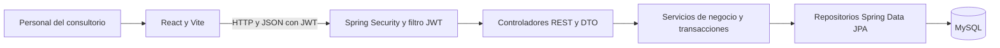
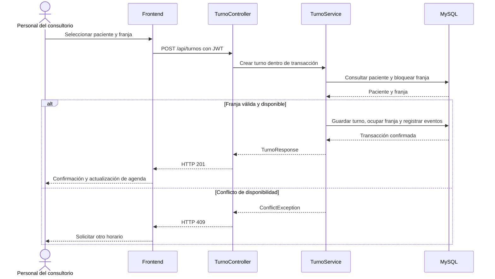

# Arquitectura y decisiones

Monolito web con frontend separado y API Spring Boot. React usa HTTP/JSON con JWT; los servicios de negocio coordinan repositorios JPA contra MySQL. Actualizado el 17 de octubre de 2026 con disponibilidad efectiva y consulta de pendientes.

## Diagrama de componentes

El filtro consulta usuarios mediante AgendaUserDetailsService. El esquema muestra las capas predominantes; ProfesionalController accede directamente a su repositorio como excepción documentada.

## Responsabilidades y fuente de verdad

| Información | Autoridad y aplicación actual |
|---|---|
| Duración y horizonte guardados | Duración fija de 40 como regla de negocio; sólo el horizonte es editable y se guarda en ConfiguracionAgenda. |
| Configuración ausente | GET devuelve 40/90 desde un objeto nuevo, sin insertarlo. PUT lo persiste. |
| Regla semanal vigente | Plantilla persistida con día, horas, duración y vigencia. No existe listado/edición de reglas por API. |
| Intervalo reservable | Franja persistida: inicio, fin y estado. La generación materializa intervalos de exactamente 40 minutos. |
| Compromiso e historial | Turno, TurnoEvento y Auditoria persistidos. |
| Formulario nuevo | Lunes a viernes y 08:00–20:00 son valores propuestos de UI; no prueban existencia de reglas en BD. |

La duración dejó de ser configurable por decisión del responsable: el backend aplica 40 en generación, plantillas, aperturas y validación de reserva. El frontend sólo informa el valor. ConfiguracionAgenda conserva la columna anterior por compatibilidad, pero expone 40 incluso si una base antigua tenía otro valor; al guardar configuración se normaliza sin alterar citas existentes.

## Límites de módulos

Controladores validan estructura y exponen DTO; servicios contienen reglas/transacciones; repositorios consultan/persisten; entidades representan el esquema. Los DTO de respuesta mapean entidades dentro de transacciones porque `open-in-view=false`. `ProfesionalController` consulta el repositorio directamente, excepción pequeña al patrón predominante.

Frontend concentra composición en App, datos diarios en useAgenda y HTTP en api.ts. La selección múltiple realiza varias llamadas al mismo contrato diario, con recuperación parcial. Ambas pantallas comparten CalendarioSemanalAgenda y el criterio de color de agendaVisual. La semana hace 15 solicitudes (14 diarias y una de excepciones); aún no existe endpoint de agenda por rango.

## Flujos transaccionales

**Reserva:** bloquear el profesional y la franja, obtener paciente activo; validar vigencia, futuro, horizonte, cierres y ausencia de un turno activo del mismo profesional que solape el intervalo. Crear turno, ocupar franja, registrar evento/auditoría y confirmar. Las escrituras de agenda utilizan el mismo bloqueo por profesional y aislamiento READ_COMMITTED para ver los cambios confirmados al esperar.

**Cancelación:** bloquear turno y validar activo; bloquear franja; guardar CANCELADO, origen y motivo. PACIENTE libera sólo sin cierre; CONSULTORIO bloquea. Registrar evento y auditoría dentro de la misma transacción.

**Reprogramación:** bloquear turno; admitir activo o cancelado CONSULTORIO; bloquear franjas en orden de ID y validar destino incluyendo cierres; mover el mismo turno; liberar origen sólo si no está cerrado y ocupar destino. Si estaba cancelado, pasa a RESERVADO. Registrar evento e IDs en la misma transacción.

**Cierre:** guardar excepción; bloquear franjas libres; mantener ocupadas; devolver IDs de turnos activos afectados. Es una respuesta posterior a la escritura, sin simulación previa. AgendaConsultaService ofrece la lista recuperable con datos de contacto y motivo; se deriva de la BD y excluye cancelaciones del paciente.

## Secuencia de reserva

Se representa el alta sobre una misma franja. El bloqueo por profesional y la consulta por intervalo cubren también franjas distintas y la generación. Las pruebas incluyen reservas superpuestas entre IDs diferentes. Generación, cierres y reserva comparten el bloqueo del profesional. El orden de bloqueos por profesional/turno/franja coordina generación, reserva y cancelación sin retirar compromisos.

## Generación por mes con duración fija

GeneracionMensual sólo selecciona el mes y llama a POST /agenda/generar-franjas; no hay previsualización ni confirmación para cambiar duración. AgendaService selecciona la regla más reciente vigente por día, aplica 40, respeta cierres y conserva intervalos existentes. Elimina sólo franjas futuras libres de otras duraciones sin referencias de Turno/TurnoEvento. Ante cualquier otro solapamiento revierte la operación completa y conserva historia. El límite mensual y la anticipación son validaciones independientes.

Se eliminó el circuito de regeneración y su migración. La consulta de pacientes para reprogramar por suspensión del consultorio permanece implementada.

## Seguridad y tiempo

Spring Security exige autenticación y roles. JwtService firma HMAC con clave externa; contraseñas BCrypt; usuario y autoridades se cargan desde BD para requests autenticados. El cliente persiste sesión en localStorage. La autorización sigue la [matriz de cuatro roles](roles-permisos.md), con rutas explícitas y denegación por defecto. El JWT incluye rol y huella de credencial: un cambio de rol/contraseña o una desactivación invalida el acceso anterior. No hay refresh token ni lista de sesiones para cierre remoto individual. Seguridad devuelve JSON con 401 para sesión inválida y 403 para permiso insuficiente; el despacho de errores no queda bloqueado por autorización.

Las fechas de negocio son LocalDate/LocalTime/LocalDateTime sin offset en JSON. JDBC/Jackson están configurados a Argentina, pero `now()` usa la zona de la JVM y el navegador interpreta fechas locales. Alinear zona de SO/JVM/navegador; no afirmar que la zona queda garantizada sólo por Jackson. No hay Clock inyectado para pruebas temporales.

## Decisiones registradas

| ID | Decisión | Estado y consecuencia |
|---|---|---|
| ADR-01 | Materializar franjas en MySQL | Implementado; generar antes de reservar, sin cálculo completo al consultar |
| ADR-02 | Conservar identidad del turno al mover | Implementado; REPROGRAMACION es evento, no estado del turno |
| ADR-03 | Mantener duración configurable, inicial 40 | Reemplazada por duración fija de 40 por pedido del responsable; conservar citas anteriores |
| ADR-04 | Un profesional operativo | Implementado; se usa el primero activo, sin selector multi-profesional |
| ADR-05 | Selección múltiple mediante contrato existente | Implementado; guardado por día no atómico, UI conserva pendientes ante fallo |
| ADR-06 | Documentación versionada junto al código | README por módulo y documentos técnicos vigentes en docs; versiones anteriores consultables en Git |

## Mantenibilidad y evolución

TurnoService pasó de 6 a 5 colaboradores inyectados. DisponibilidadService concentra validación/reserva/liberación, bloqueo del profesional y persistencia de franjas con 5; AgendaConsultaService consulta excepciones y pendientes con 2. AgendaService conserva 7 y sigue siendo candidato a separar generación/excepciones. No se infiere calidad desde un promedio de imports: mantener responsabilidades claras y transacciones completas.

La lista de afectados usa fetch joins y un DTO con contacto, evitando consultas por paciente. La página Reprogramaciones reutiliza TurnoDialog y tiene su propio estado de guardado; no depende de que la agenda diaria esté cargada. Un endpoint de agenda por rango para reducir peticiones semanales continúa pendiente. Ver [mantenimiento](mantenimiento-contribucion.md) y [pendientes](pendientes-riesgos.md).
