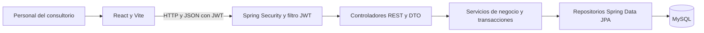
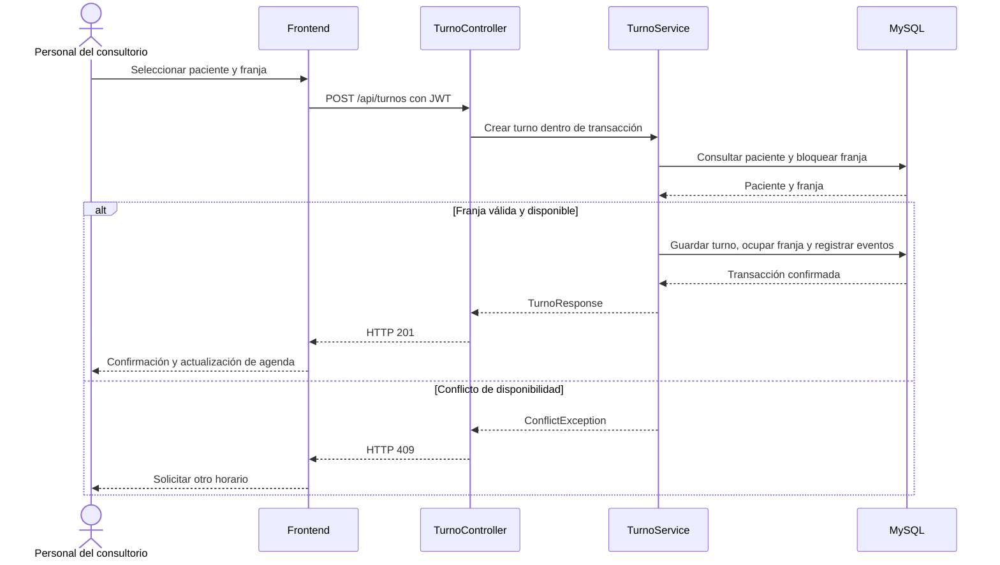

# Arquitectura y decisiones

Monolito web con frontend separado y API Spring Boot. React usa HTTP/JSON con JWT; los servicios de negocio coordinan repositorios JPA contra MySQL. Base revisada: `96fc37a`.

## Diagrama de componentes

El filtro consulta usuarios mediante AgendaUserDetailsService. El esquema muestra las capas predominantes; ProfesionalController accede directamente a su repositorio como excepción documentada.

## Responsabilidades y fuente de verdad

| Información | Autoridad y aplicación actual |
|---|---|
| Duración y horizonte guardados | Fila de ConfiguracionAgenda en BD. El backend entrega/actualiza; frontend muestra y edita un borrador. |
| Configuración ausente | GET devuelve 40/90 desde un objeto nuevo, sin insertarlo. PUT lo persiste. |
| Regla semanal vigente | Plantilla persistida con día, horas, duración y vigencia. No existe listado/edición de reglas por API. |
| Intervalo reservable | Franja persistida: inicio, fin y estado. La generación usa duración de plantilla. |
| Compromiso e historial | Turno, TurnoEvento y Auditoria persistidos. |
| Formulario nuevo | Lunes a viernes y 08:00–20:00 son valores propuestos de UI; no prueban existencia de reglas en BD. |

No hay dos fuentes de verdad por tener frontend y backend: hay borradores de interfaz y datos persistidos. Sí hay duraciones independientes en configuración, plantillas y apertura. El frontend semanal ya usa la configuración guardada; el endpoint de plantilla todavía acepta una duración propia y la apertura usa la recibida. Esa coherencia es un pendiente de negocio.

## Límites de módulos

Controladores validan estructura y exponen DTO; servicios contienen reglas/transacciones; repositorios consultan/persisten; entidades representan el esquema. Los DTO de respuesta mapean entidades dentro de transacciones porque `open-in-view=false`. `ProfesionalController` consulta el repositorio directamente, excepción pequeña al patrón predominante.

Frontend concentra composición en App, datos diarios en useAgenda y HTTP en api.ts. La selección múltiple realiza varias llamadas al mismo contrato diario, con recuperación parcial. Los calendarios semanales hacen 7 o 14 solicitudes; aún no existe endpoint de agenda por rango.

## Flujos transaccionales

**Reserva:** obtener paciente activo; bloquear franja por ID con PESSIMISTIC_WRITE; validar futuro, horizonte, estado libre y ausencia de turno activo; crear turno; ocupar franja; registrar evento y auditoría; confirmar transacción. La unicidad profesional/inicio evita inicios idénticos de franjas, no intervalos superpuestos.

**Cancelación:** validar turno activo; bloquear franja; cambiar estado a CANCELADO; liberar; registrar evento y auditoría. Falta consultar cierres al liberar.

**Reprogramación:** validar turno activo; bloquear origen y destino; validar destino; mover el mismo turno; liberar origen y ocupar destino; registrar IDs en evento. Falta protección común del turno frente a dos cambios simultáneos y orden estable de bloqueo.

**Cierre:** guardar excepción; bloquear franjas libres; mantener ocupadas; devolver IDs de turnos activos afectados. Es una respuesta posterior a la escritura, sin simulación previa ni bandeja recuperable.

## Secuencia de reserva

Se representa el alta sobre una misma franja. No implica que los solapamientos entre franjas distintas o los cambios concurrentes del mismo turno estén resueltos.

## Seguridad y tiempo

Spring Security exige autenticación y roles. JwtService firma HMAC con clave externa; contraseñas BCrypt; usuario y autoridades se cargan desde BD para requests autenticados. El cliente persiste sesión en localStorage. No hay refresh token ni revocación/lista de sesiones implementada. Los errores de autenticación no tienen aún un contrato uniforme 401/403.

Las fechas de negocio son LocalDate/LocalTime/LocalDateTime sin offset en JSON. JDBC/Jackson están configurados a Argentina, pero `now()` usa la zona de la JVM y el navegador interpreta fechas locales. Alinear zona de SO/JVM/navegador; no afirmar que la zona queda garantizada sólo por Jackson. No hay Clock inyectado para pruebas temporales.

## Decisiones registradas

| ID | Decisión | Estado y consecuencia |
|---|---|---|
| ADR-01 | Materializar franjas en MySQL | Implementado; generar antes de reservar, sin cálculo completo al consultar |
| ADR-02 | Conservar identidad del turno al mover | Implementado; REPROGRAMACION es evento, no estado del turno |
| ADR-03 | Mantener duración configurable, inicial 40 | Implementado en configuración; conservar valores históricos y cerrar coherencia pendiente |
| ADR-04 | Un profesional operativo | Implementado; se usa el primero activo, sin selector multi-profesional |
| ADR-05 | Selección múltiple mediante contrato existente | Implementado; guardado por día no atómico, UI conserva pendientes ante fallo |
| ADR-06 | Documentación versionada junto al código | Decisión actual del responsable; README por módulo, documentos técnicos en docs e históricos separados |

## Mantenibilidad y evolución

En la auditoría inicial AgendaService tenía 7 colaboradores y TurnoService 6. No se infiere calidad desde un promedio bajo de imports. Propuesta: separar lectura de agenda, generación y excepciones; centralizar disponibilidad efectiva para reservar/liberar/cerrar; reducir coordinación en App sin agregar capas de delegación vacías. Mantener transacciones de negocio completas.

La lista de afectados debería resolverse en una consulta/DTO con contacto, evitando que el frontend consulte un paciente por cada fila. Un endpoint por rango puede reducir peticiones semanales. Son propuestas, no capacidades implementadas. Ver [mantenimiento](mantenimiento-contribucion.md) y [pendientes](pendientes-riesgos.md).
