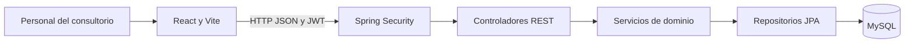
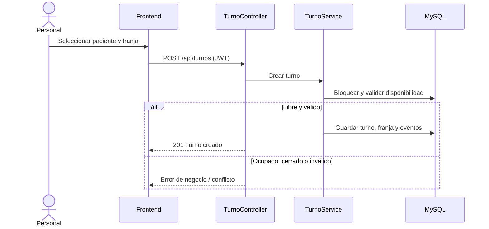

# Arquitectura y decisiones de diseño

**Revisión:** 29/10/2026, versión posterior a modularización y retiro de aperturas extraordinarias. Las decisiones del análisis inicial que se descartaron se conservan en Git y en el [documento fuente](referencias/README.md).

## Vista de componentes

El backend es un monolito por capas, con frontend independiente. Los controladores presentan DTO y aplican validaciones estructurales; los servicios coordinan reglas y transacciones; los repositorios encapsulan persistencia. No se agregaron interfaces o capas solo por cantidad de archivos.

## Modularidad y responsabilidades

| Módulo | Responsabilidad |
|---|---|
| `HorarioConsultorio` | Regla fija de días, horas y alineación de franjas: lunes a viernes, 08:00–20:00, 40 min. |
| `PlanificacionHorariosService` | Generar franjas de un mes, respetar cierres, no duplicar ni eliminar compromisos. Consulta el período de forma agrupada. |
| `AgendaService` | Consultar agenda/disponibilidad y realizar cierres con revisión de afectados. |
| `AgendaConsultaService` | Consultar suspensiones y pacientes pendientes de reprogramación. |
| `AgendaRangoService` | Consulta por período con un conjunto acotado de lecturas, evitando una llamada SQL por día. |
| `TurnoService` / `DisponibilidadService` | Ciclo de vida del turno, revalidación de intervalos, transacciones y estados de franjas. |
| `PacienteService` | Datos mínimos de pacientes, búsquedas y baja lógica. |
| `AuditoriaService` | Registro de operaciones críticas. |
| `App.tsx`, `api.ts`, `useAgenda` | Navegación/sesión, HTTP y estado de agenda en React. |
| `CalendarioSemanalAgenda`, `CalendarioRangoAgenda`, `DiaCalendarioAgenda` | Cada vista controla su navegación; comparten representación de días, horarios y cierres. |

La separación de generación respecto de consultas/cierres y la extracción de un día reutilizable mejoraron **cohesión, acoplamiento y mantenibilidad**, sin cambiar el diseño visual ni ampliar el problema. No se afirma que toda clase extensa sea un defecto: se evalúan responsabilidades y dependencias concretas.

## Regla de horario y límite de reserva

El horario confirmado por Salvador **no es configurable**. Las franjas se generan de lunes a viernes de 08:00 a 20:00, dieciocho por día, de 40 minutos. Se habilita por mes: el actual (solo horarios futuros) y los **tres meses calendario siguientes completos**. La regla de tres meses es una decisión interna del equipo, no una exigencia expresamente enviada por el cliente.

Las viejas tablas/campos de plantillas y horizonte en días pueden seguir en el esquema **por compatibilidad**, pero no definen el comportamiento de disponibilidad en esta versión. No hay endpoints para crear o administrar plantillas. No se crean aperturas extraordinarias ni se ofrecen franjas fuera del horario habitual, aunque existan registros históricos. La aplicación conserva turnos antiguos, incluidos los que ya estaban comprometidos, sin reescribirlos.

## Operaciones críticas

**Reserva:** autenticación/autorización; bloqueo por profesional y franjas; comprobación de futuro, horario fijo, cierre, solapamiento e identidad del paciente; ocupación de franja y creación de evento dentro de la transacción. Dos reservas competidoras no deberían confirmar el mismo intervalo.

**Cancelación:** conserva el registro del turno y su historial. Libera franja si corresponde; los cierres prevalecen. Distingue cancelación solicitada por paciente de la originada en el consultorio.

**Reprogramación:** conserva el ID del turno, valida destino, registra actor, motivo, horario anterior y nuevo; al mover turnos afectados por cierres conserva la trazabilidad de la suspensión.

**Suspensión:** la pantalla primero llama `POST /api/agenda/bloqueos/previsualizacion`, que devuelve afectados **sin escribir**. En `POST /api/agenda/bloqueos` el servicio bloquea al profesional, comprueba que los mismos turnos sigan afectados y, si es así, registra un cierre y bloquea franjas libres. Si hay cambios concurrentes, responde 409 y se exige otra revisión. Los compromisos se mantienen para reprogramarlos después. Los feriados se representan como cierres manuales, no como un servicio especial.

## Seguridad y persistencia

Spring Security con JWT, roles y BCrypt. Los filtros/controladores restringen modificaciones, y la interfaz refleja esos permisos sin reemplazar la autorización del backend. MySQL conserva usuarios, pacientes, franjas, turnos y eventos; las operaciones críticas usan transacciones y bloqueos pesimistas. El código usa la zona `America/Argentina/Buenos_Aires` para reglas de negocio; no se calculan días civiles desde el huso local del navegador.

El código conserva `TipoExcepcionAgenda.APERTURA` y el campo `origen=EXCEPCION_APERTURA` **solo para interpretar datos antiguos**. No hay endpoint de creación de aperturas; `HorarioConsultorio.esReservablePorHorario` no habilita nuevas reservas por ese origen. Los turnos históricos no se borran.

## Diagrama de reserva (resumido)

## Calidad y límites

La consulta semanal/rango agrupa operaciones y la generación mensual evita SELECT repetidos por franja. La evaluación de índices, N+1, p95/p99 y escenarios de carga queda sujeta a mediciones; no se atribuyen tiempos de respuesta sin evidencia. No se rediseña la base ni se añaden patrones innecesarios para este MVP. La etapa de Testing formalizará los casos de aceptación.
