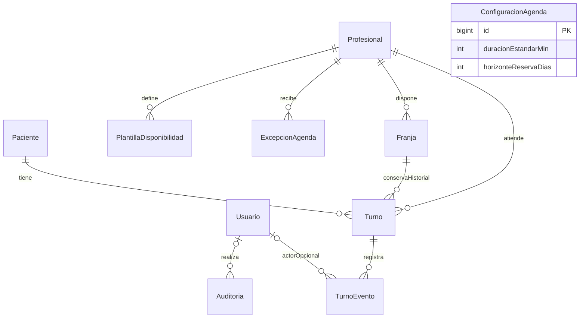
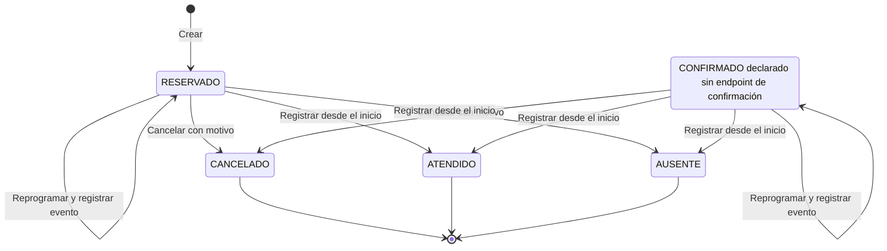

# Modelo de datos y estados

Modelo lógico derivado de las diez entidades JPA actuales. MySQL conserva configuración, pacientes, reglas, franjas y compromisos. Los nombres y restricciones se basan en las entidades del commit `96fc37a`; no existe un esquema versionado por migraciones.

## Entidades

| Entidad / tabla | Campos y responsabilidad |
|---|---|
| Usuario / usuarios | ID, email único, password_hash, rol, activo, created_at, updated_at. Cuenta operativa. |
| Paciente / pacientes | ID, DNI único, nombre, apellido, teléfono/email opcionales, activo y marcas de tiempo. |
| Profesional / profesionales | ID, nombre, apellido, matrícula única, activo y marcas de tiempo. |
| ConfiguracionAgenda / configuracion_agenda | ID fijo 1, duracion_estandar_min, horizonte_reserva_dias. Valores iniciales 40/90 si falta la fila. |
| PlantillaDisponibilidad / plantillas_disponibilidad | Profesional, día de semana, inicio/fin, duracion_min, vigencia_desde/hasta. |
| ExcepcionAgenda / excepciones_agenda | Profesional, fecha, horas opcionales, tipo APERTURA/CIERRE, motivo. |
| Franja / franjas | Profesional, inicio/fin concretos, estado, origen y version. |
| Turno / turnos | Paciente, profesional, franja, copia de inicio/fin, estado, motivo_consulta, created_at y updated_at. |
| TurnoEvento / turno_eventos | Turno, tipo, fecha, usuario opcional, franja_anterior_id/nueva_id y detalle. |
| Auditoria / auditoria | Usuario opcional, acción, entidad, entidad_id, fecha y metadata. |

Las entidades relacionadas por JPA utilizan claves foráneas. Turno referencia una Franja, pero la relación no es única: un horario cancelado puede reutilizarse conservando los turnos anteriores. Los IDs históricos de franja en TurnoEvento son valores escalares, no relaciones JPA. No hay relación persistida específica que represente la gestión pendiente de un turno afectado por un cierre.

## Relaciones principales

ConfiguracionAgenda es una fila independiente. El actor de TurnoEvento es una relación opcional existente en el modelo; su asignación en el flujo actual sigue pendiente. Varias reservas históricas pueden referenciar la misma franja, aunque sólo una debería estar activa.

## Restricciones e índices

- DNI de paciente, email de usuario y matrícula profesional son únicos.
- Franja tiene unicidad `(profesional_id, inicio)` y versión optimista; la reserva usa además bloqueo pesimista.
- Turno se indexa por profesional/inicio, paciente y estado; no tiene campo `@Version`.
- Plantilla y excepción se indexan por profesional/vigencia y profesional/fecha respectivamente.
- Eventos se indexan por turno/fecha; auditoría por entidad/ID/fecha; pacientes por DNI y apellido.

La unicidad de inicio no impide que 09:00–09:40 y 09:20–10:00 coexistan. Tampoco existe una restricción SQL que por sí sola limite los turnos activos a uno por franja; la garantía actual depende de la transacción y su bloqueo.

## Estados

| Objeto | Estado | Significado |
|---|---|---|
| Franja | LIBRE | Estado persistido potencialmente reservable; todavía debe validar futuro/horizonte y cierres efectivos |
| Franja | OCUPADA | Asociada a un compromiso reservado o ya resuelto |
| Franja | BLOQUEADA | Cerrada para nuevas reservas |
| Turno | RESERVADO | Activo, cancelable o reprogramable |
| Turno | CONFIRMADO | Activo; no hay operación específica de confirmación |
| Turno | CANCELADO | Historial conservado; no se reactiva por flujo normal |
| Turno | ATENDIDO | Final, sólo desde inicio |
| Turno | AUSENTE | Final, sólo desde inicio |

Crear produce RESERVADO. Cancelar cambia un activo a CANCELADO. Reprogramar conserva ID y estado activo, actualiza franja/horas y agrega un evento REPROGRAMACION. Atender/ausente cierra un activo. Los eventos CREACION, CONFIRMACION, CANCELACION, REPROGRAMACION, ATENCION y AUSENCIA están definidos; CONFIRMACION no tiene flujo de escritura expuesto.

Registrar ATENDIDO/AUSENTE no cambia la franja a LIBRE. Bajar un paciente usa activo=false, sin borrar turnos. No hay DELETE de turnos en la API.

## Ciclo de vida implementado

No se dibuja una transición de reserva a confirmado porque no existe operación de confirmación expuesta. Reprogramar conserva el estado y la identidad; no agrega un estado REPROGRAMADO.

## Duración e historia

Configuración, plantilla y franja expresan conceptos distintos. La configuración vigente orienta nuevas reglas; una plantilla guarda su duración; la franja materializa inicio/fin; el turno copia el compromiso. Cambiar 40 a 30 en configuración no reescribe esos datos históricos. Cualquier adecuación de franjas libres debe analizar solapamientos y preservar compromisos antes de aplicar una migración.

El esquema usa fecha/hora local sin offset. Alinear zona de JVM/BD/cliente y documentar conversión si se incorporan otras zonas. Las anotaciones de Jackson/JDBC no corrigen por sí mismas la zona de `now()`.

## Evolución del esquema

Actualmente se usa `ddl-auto=update` para desarrollo y create-drop en test. Antes de producción incorporar migraciones revisadas, respaldo/restauración y una prueba de actualización desde una base anterior. No ejecutar SQL de corrección masiva sobre datos reales sin una migración y validación específicas.
