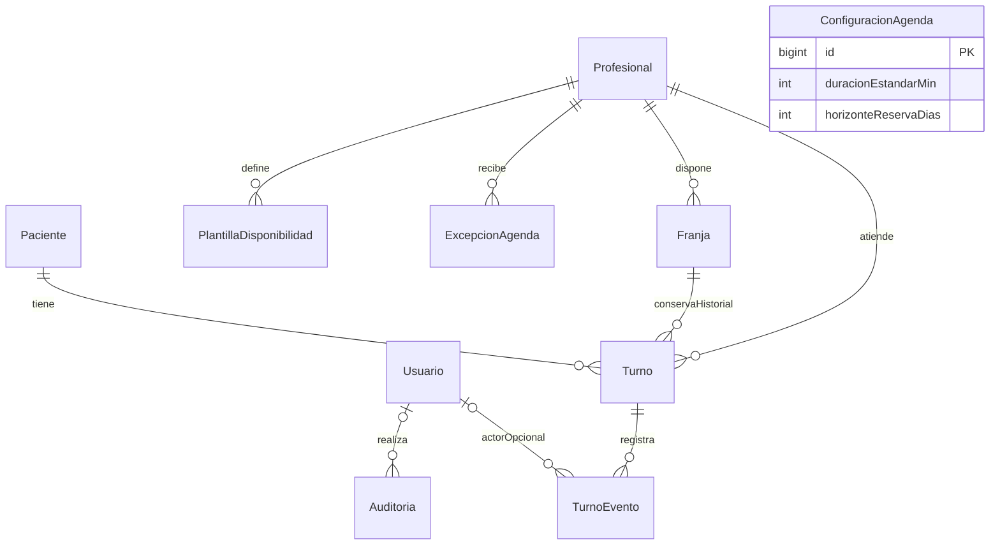
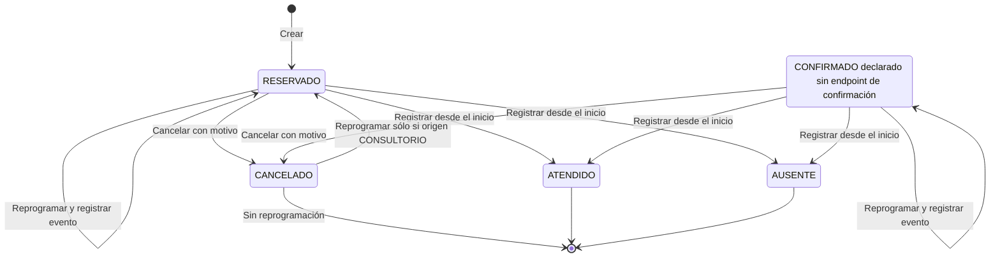

# Modelo de datos y estados

Modelo lógico derivado de las diez entidades JPA actuales. MySQL conserva configuración, pacientes, reglas, franjas y compromisos. Los nombres y restricciones se basan en las entidades revisadas el 17 de octubre de 2026; no existe un esquema versionado por migraciones.

## Entidades

| Entidad / tabla | Campos y responsabilidad |
|---|---|
| Usuario / usuarios | ID, email único, password_hash, rol, activo, created_at, updated_at. Cuenta operativa. |
| Paciente / pacientes | ID, DNI único, nombre, apellido, teléfono/email opcionales, activo y marcas de tiempo. |
| Profesional / profesionales | ID, nombre, apellido, matrícula única, activo y marcas de tiempo. |
| ConfiguracionAgenda / configuracion_agenda | ID fijo 1, duracion_estandar_min, horizonte_reserva_dias. Duración fija 40; horizonte inicial 45 si falta la fila. La columna de duración se conserva por compatibilidad. |
| PlantillaDisponibilidad / plantillas_disponibilidad | Profesional, día de semana, inicio/fin, duracion_min, vigencia_desde/hasta. |
| ExcepcionAgenda / excepciones_agenda | Profesional, fecha, horas opcionales, tipo CIERRE; APERTURA se conserva solo para leer datos históricos, no para nuevas operaciones. |
| Franja / franjas | Profesional, inicio/fin concretos, estado, origen y version. |
| Turno / turnos | Paciente, profesional, franja, copia de inicio/fin, estado, motivo_consulta, origen_cancelacion nullable (PACIENTE/CONSULTORIO), motivo_cancelacion nullable, created_at y updated_at. |
| TurnoEvento / turno_eventos | Turno, tipo, fecha, usuario opcional, franja_anterior_id/nueva_id y detalle. |
| Auditoria / auditoria | Usuario opcional, acción, entidad, entidad_id, fecha y metadata. |

Las entidades relacionadas por JPA utilizan claves foráneas. Turno referencia una Franja, pero la relación no es única: un horario cancelado puede reutilizarse conservando los turnos anteriores. Los IDs históricos de franja en TurnoEvento son valores escalares, no relaciones JPA. Los pendientes se derivan de turnos activos que solapan un CIERRE y de cancelados con origen CONSULTORIO. No hay una cola en memoria ni una tabla duplicada; al mover el turno se recalcula su pertenencia.

## Relaciones principales

ConfiguracionAgenda es una fila independiente. El actor de TurnoEvento se informa para eventos nuevos; los registros históricos previos pueden tener `usuario_id` nulo. Varias reservas históricas pueden referenciar la misma franja, aunque sólo una debería estar activa.

## Restricciones e índices

- DNI de paciente, email de usuario y matrícula profesional son únicos.
- Franja tiene unicidad `(profesional_id, inicio)` y versión optimista. Las mutaciones se coordinan con bloqueo pesimista del profesional y validación de intervalos.
- Turno se indexa por profesional/inicio, paciente y estado; no tiene `@Version`, pero sus modificaciones usan PESSIMISTIC_WRITE. Las franjas de reprogramación se bloquean en orden ascendente de ID.
- Plantilla y excepción se indexan por profesional/vigencia y profesional/fecha respectivamente.
- Eventos se indexan por turno/fecha; auditoría por entidad/ID/fecha; pacientes por DNI y apellido.

La unicidad SQL no protege intervalos completos: la garantía de no superposición depende del bloqueo común del profesional, consultas por intervalo y transacciones READ_COMMITTED. Las franjas antiguas de otra duración no admiten nuevas reservas. Sólo se eliminan durante generación si están libres, futuras y sin referencias de turnos/eventos.

## Estados

| Objeto | Estado | Significado |
|---|---|---|
| Franja | LIBRE | Estado persistido potencialmente reservable; todavía debe validar futuro/horizonte y cierres efectivos |
| Franja | OCUPADA | Asociada a un compromiso reservado o ya resuelto |
| Franja | BLOQUEADA | Cerrada para nuevas reservas |
| Turno | RESERVADO | Activo, cancelable o reprogramable |
| Turno | CONFIRMADO | Activo; no hay operación específica de confirmación |
| Turno | CANCELADO | Historial conservado; sólo origen CONSULTORIO permite reprogramar a RESERVADO |
| Turno | ATENDIDO | Final, sólo desde inicio |
| Turno | AUSENTE | Final, sólo desde inicio |

Crear produce RESERVADO. Cancelar cambia un activo a CANCELADO. Reprogramar conserva ID y estado activo, actualiza franja/horas y agrega un evento REPROGRAMACION. Atender/ausente cierra un activo. Los eventos CREACION, CONFIRMACION, CANCELACION, REPROGRAMACION, ATENCION y AUSENCIA están definidos; CONFIRMACION no tiene flujo de escritura expuesto.

Registrar ATENDIDO/AUSENTE no cambia la franja a LIBRE. Bajar un paciente usa activo=false, sin borrar turnos. No hay DELETE de turnos en la API.

## Ciclo de vida implementado

No se dibuja una transición de reserva a confirmado porque no existe operación de confirmación expuesta. Reprogramar conserva identidad y estado activo; si estaba cancelado por el consultorio vuelve a RESERVADO; no agrega un estado REPROGRAMADO.

## Duración e historia

Los turnos nuevos duran exactamente 40 minutos por decisión del responsable. ConfiguracionAgenda expone la constante y rechaza cambios; la columna previa permanece por compatibilidad, sin autorizar otras duraciones. La plantilla conserva horarios/vigencia y puede contener duración histórica; la generación usa 40. El turno copia su compromiso y no se reescribe automáticamente.

El esquema usa fecha/hora civil de Buenos Aires sin offset. `TiempoAgenda` fija la zona de los cálculos y timestamps del backend; el frontend interpreta estos valores como hora de Buenos Aires. Las anotaciones de Jackson/JDBC se mantienen alineadas, pero no reemplazan esa referencia explícita. La corrección de zona no modifica filas previas ni supone qué zona se usó al grabarlas.

## Evolución del esquema

No se requiere la migración mensual: se retiraron vigente, inicio_vigente y el reemplazo de índices propuestos para cambios de duración. Si se llegó a aplicar ese script anterior sin regenerar meses, sus columnas adicionales pueden permanecer; la aplicación no las utiliza.

Actualmente se usa `ddl-auto=update` para desarrollo y create-drop en test. Este cambio agrega dos columnas nullable; el [SQL aditivo](../backend/sql/2026-10-17-origen-cancelacion.sql) sirve para esquemas previos con DDL manual y sólo si las columnas faltan. No se migran motivos/orígenes por conjetura: cancelaciones anteriores permanecen sin origen conocido. Antes de producción incorporar migraciones revisadas, respaldo/restauración y una prueba de actualización desde una base anterior. No ejecutar SQL de corrección masiva sobre datos reales sin una migración y validación específicas.

## Procedencia de una reprogramación

`turnos.reprogramado_por_consultorio` es booleano, inicialmente false. Se activa al reprogramar por cancelación CONSULTORIO o cierre que afectaba al horario de origen, y conserva esa procedencia. No depende del motivo libre ni se borra al limpiar los campos actuales de cancelación. El [SQL aditivo](../backend/sql/2026-10-17-reprogramado-consultorio.sql) agrega la columna si falta y permite recuperar marcas antiguas sólo cuando existe una cancelación CONSULTORIO explícita seguida por un evento REPROGRAMACION. Los cierres antiguos sin causa inequívoca registrada no se infieren. Con ddl-auto=update, Hibernate agrega la columna al reiniciar; el UPDATE de recuperación se puede ejecutar por separado.
